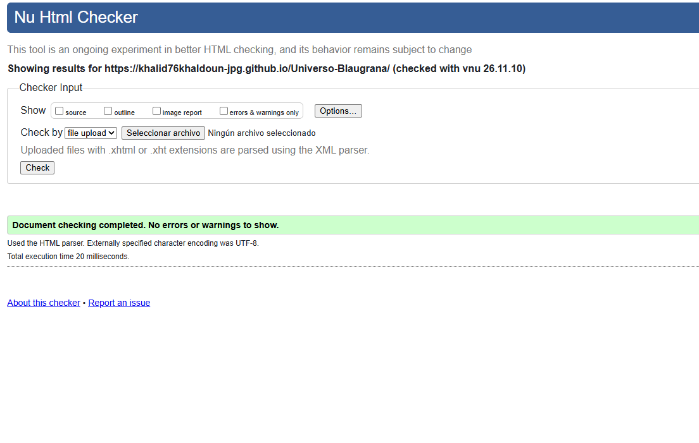
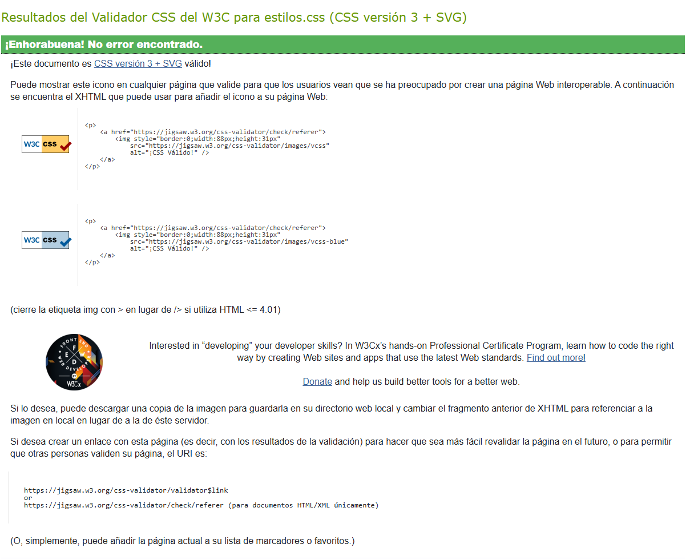

El repositorio incluirá un README.md completo.
Puedes utilizar esta plantilla:
# Universo Blaugrana
La web es sobre todos los datos, noticias, inscripciones e información para los socios de FC Barcelona.
## Autoría
- Nombre y apellidos: Khalid Echchadli khaldoun
- Curso: 1 Dam a 
- Módulo: Lenguaje de marcas
- Fecha: 11/11/2026
## Sitio publicado
- Web en GitHub Pages: [Abrir sitio](https://khalid76khaldoun-jpg.github.io/Universo-Blaugrana/)
- Repositorio: [Abrir repositorio](https://github.com/khalid76khaldoun-jpg/Universo-Blaugrana.git)
## Estructura del proyecto
- `index.html`: descripción de la página principal.
- `blog.html`: descripción del artículo.
- `tabla.html`: descripción de la información tabular.
- `galeria.html`: descripción de la galería y los recursos multimedia.
- `formulario.html`: descripción del formulario.
- `rss.xml`: descripción del canal RSS.
- `css/estilos.css`: estilos básicos compartidos.
## Tecnologías utilizadas
- HTML5
- CSS
- XML y RSS
- GitLMSGI UD 2. HTML 5
- GitHub
- GitHub Pages
## Características principales
- Navegación entre cinco páginas.
- Uso de HTML semántico.
- Tabla accesible.
- Galería con varios formatos.
- Contenido multimedia.
- Formulario con validación HTML.
- Canal RSS.
## Validación
### HTML

### CSS

### RSS

## Dificultades encontradas
Describe al menos tres dificultades reales:
1. Primera dificultad y cómo se resolvió.
2. Segunda dificultad y cómo se resolvió.
3. Tercera dificultad y cómo se resolvió.LMSGI UD 2. HTML 5
## Decisiones técnicas
Explica brevemente:
- Cómo has organizado los archivos.
- Qué partes de la plantilla se repiten.
- Qué cambia en cada página.
- Por qué has elegido determinados formatos de imagen.
- Cómo has utilizado rutas relativas.
- Cómo has preparado el proyecto para la siguiente práctica de CSS.
## Fuentes y licencias
Indica el origen, autoría y licencia de las imágenes, audios, vídeos, textos y otros recursos que no
sean propios.